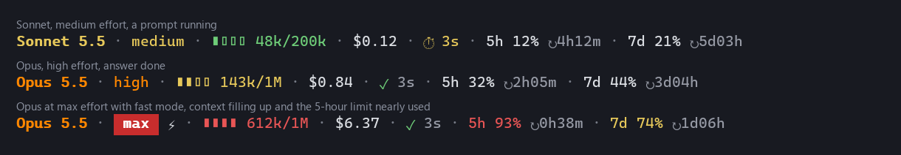

<h1 align="center">LinuxScripts</h1>

<p align="center">
  <strong>My whole Fedora setup, rebuilt from a fresh install with one command.</strong><br>
  Packages, apps, desktop layout, terminal look and everyday scripts, all kept in one place and re-applied safely whenever something drifts.
</p>

```bash
curl -fsSL https://raw.githubusercontent.com/GabGP/LinuxScripts/main/bootstrap.sh | bash
```

> [!NOTE]
> This is tailored to my own machine: Fedora KDE Plasma with DNF, Flatpak, Kitty, Starship, Rust and the Antigravity CLI (`agy`). Fork it and edit the lists to make it yours.

---

## What's inside

- **One-command rebuild.** On a fresh Fedora KDE Plasma install, the command above installs [Ansible](https://www.ansible.com/), downloads this repo and sets up everything that differs from a stock system: software sources, packages to add and remove, Flatpak apps, kernel options, user groups, tools installed outside the package manager (Rust, Starship, Claude Code, fonts, VS Code extensions), my config files, and the Plasma panel layout and window tiling.
- **Safe to run again.** Each run only changes what has drifted, so it doubles as a way to keep a machine in shape.
- **A custom terminal.** Kitty with a status bar showing live weather, RAM, CPU load and temperature, battery and the time, plus icons for 197+ commands. Starship gives the prompt a matching powerline look.
- **AI coding statuslines.** Small scripts that show, under the Claude Code and Antigravity CLI prompts, the model, effort level, how full the context window is, the session cost, a timer for the current answer, and usage limits with reset countdowns. Each comes with its own tests.
- **Everyday scripts.** `update` updates everything at once (DNF, Flatpak, Starship, `agy`, Rust), `check-updates` lists what's pending without changing anything, and `ezin` installs downloaded archives into `/opt`.

### The Claude Code statusline

<p align="center">
  
</p>

<p align="center"><sub>Real output of <code>config/claude/statusline.js</code> for three sample sessions. Colours warn as the context fills up and usage limits get close.</sub></p>

---

## Rebuilding a whole system

On a fresh **Fedora KDE Plasma** install, log in and run the command at the top. It installs Ansible and the `community.general` collection, clones this repo to `~/Desktop/LinuxScripts`, and runs `ansible/site.yml`.

- **What gets installed** is listed in [`ansible/group_vars/all.yml`](ansible/group_vars/all.yml): packages, Flatpaks, removals, tools and the tiling layout.
- **Personal values** (your git name and email) stay out of git: the first run asks for them and saves them to `ansible/personal.yml`, which is gitignored. [`ansible/personal.example.yml`](ansible/personal.example.yml) lists the keys.
- **Always run the playbook through `bootstrap.sh`**, which makes sure the Ansible collection is installed. Extra arguments go straight to `ansible-playbook`:

```bash
./bootstrap.sh -t kde              # only some roles: repos packages flatpaks system tools dotfiles kde
./bootstrap.sh --check --diff      # dry run: show what would change
```

**The desktop layout.** After changing the Plasma panel, run `scripts/save-plasma-layout.sh` and commit `config/plasma/layout.js`. The playbook replays that file only when it differs from the last layout applied on that machine, so live tweaks aren't undone on every run. Log out and back in after the `kde` role.

**Not automated:** the Antigravity CLI (`agy`; the playbook reminds you) and Radmin VPN under Wine.

---

## Just the config files

```bash
git clone https://github.com/GabGP/LinuxScripts.git
cd LinuxScripts
./setup.sh
```

`setup.sh` opens a menu:

| Option | What it does |
| :--- | :--- |
| **Configurations** | Links the config files (Kitty, Starship, Bash, Claude, Antigravity) into place. Existing files are backed up to `backups/` first. Install all of them or pick some. |
| **Automation scripts** | Links the scripts into `~/.local/bin/` so you can run them as commands (`update`, `check-updates`, `ezin`). |
| **Both** | Does both. |

You'll need a few system packages and, for the icons, the MesloLGS Nerd Font:

```bash
sudo dnf install file tar unzip sed desktop-file-utils curl

mkdir -p ~/.local/share/fonts/Meslo
curl -fLo /tmp/Meslo.tar.xz https://github.com/ryanoasis/nerd-fonts/releases/latest/download/Meslo.tar.xz
tar -xf /tmp/Meslo.tar.xz -C ~/.local/share/fonts/Meslo/
rm -f /tmp/Meslo.tar.xz
fc-cache -f ~/.local/share/fonts/Meslo
```

---

## The configs in detail

- **Kitty:** MesloLGS Nerd Font, a powerline-style tab bar configured in one file (`tab_bar.conf`), and live widgets on the right (weather from Open-Meteo, RAM, CPU load and temperature, battery, 24-hour clock). **F1** opens `btop` on top. New widgets are picked up automatically by dropping a file into `tab_bar/modules/`. See the [tab bar guide](config/kitty/tab_bar/README.md).
- **Starship:** a continuous powerline prompt inspired by [Gruvbox Rainbow](https://starship.rs/presets/gruvbox-rainbow). Change the palette by editing the colour variables at the top of [`starship.toml`](config/starship/starship.toml).
- **Bash:** environment variables, paths and the Starship hook.
- **Claude Code statusline:** model coloured by tier (Haiku green, Sonnet yellow, Opus orange), effort coloured by intensity (`max` as a red badge), fast mode (`⚡`), a 4-bar context meter that changes colour as it fills, session cost in USD, a timer that runs while Claude answers (`⏱ 14s`) and freezes when it's done (`✓ 14s`), and 5-hour and 7-day usage with reset countdowns. No dependencies, 36 tests. See [`config/claude/README.md`](config/claude/README.md).
- **Claude Code skill `gemini-worker`:** lets a Claude Code session hand a task to the Antigravity CLI (Gemini) as a background command and read back its report. Every call is logged to `~/.claude/gemini-calls.log`. Needs `agy` and `node`.
- **Antigravity CLI statusline:** the same design for `agy`, plus the current git branch. 28 tests. See [`config/agy/README.md`](config/agy/README.md).

---

## Repository layout

```text
LinuxScripts/
├── bootstrap.sh          # fresh-install entry point: installs Ansible, runs the playbook
├── setup.sh              # menu for linking just the configs and scripts
├── ansible/              # the full-system playbook (site.yml, group_vars/all.yml, roles/)
├── config/
│   ├── kitty/            # kitty.conf, themes, and the modular tab bar
│   ├── starship/         # starship.toml
│   ├── bash/             # .bashrc
│   ├── claude/           # Claude Code statusline, its tests, and the gemini-worker skill
│   ├── agy/              # Antigravity CLI statusline and its tests
│   └── plasma/           # saved panel and desktop layout
├── scripts/              # update, check-updates, ezin, save-plasma-layout, shared helpers
└── backups/              # automatic backups of replaced configs (gitignored)
```

---

Made by [@GabGP](https://github.com/GabGP). Released under the [MIT License](LICENSE).
